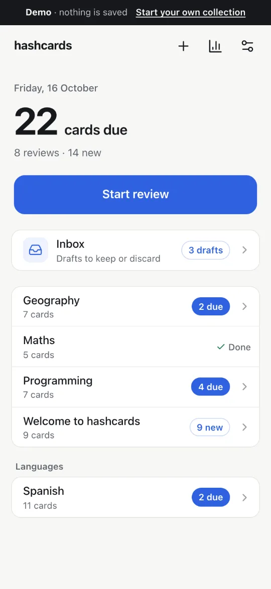
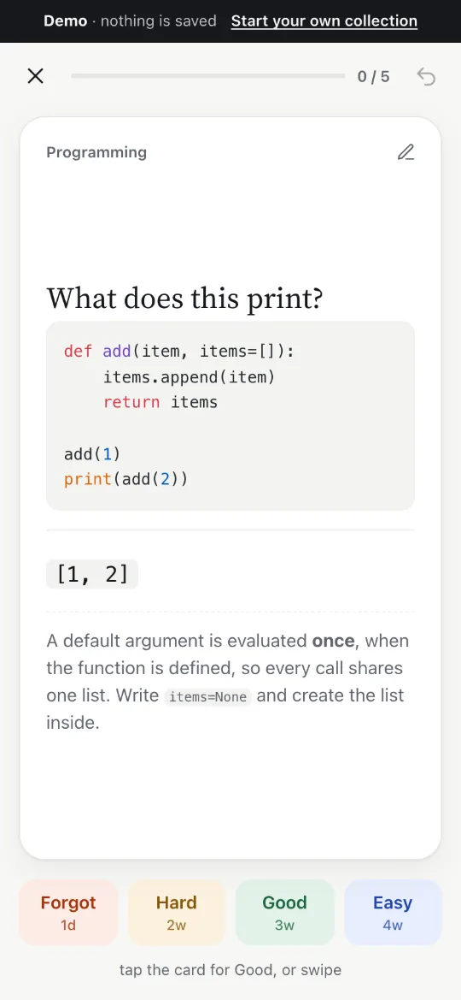
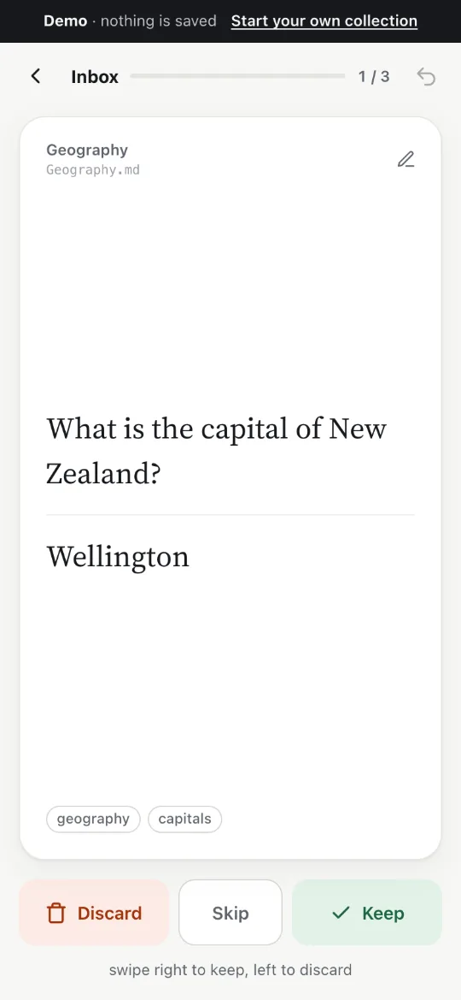
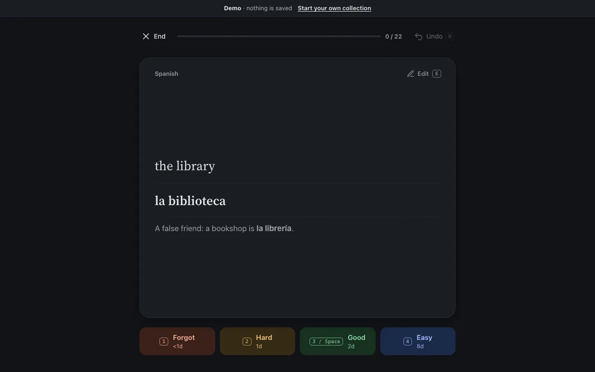
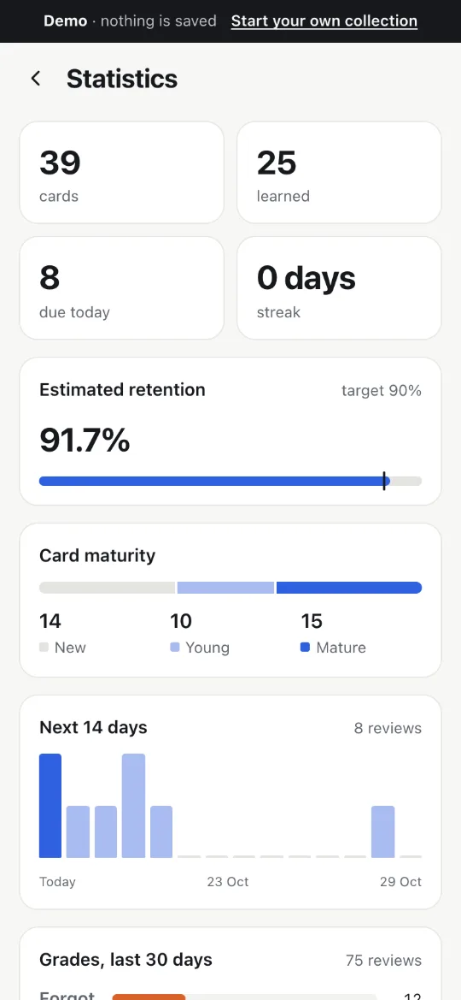

# Hashcards

**Spaced-repetition flashcards you write in Markdown, keep in your own GitHub
repository, and review anywhere.** · [hashcards.dev](https://hashcards.dev)

<p align="center">
  
  
  
</p>
<p align="center">
  
  
</p>

## Quick start

1. **[Try the demo](https://hashcards.dev/#demo).** The whole app on sample
   decks, with no account. Nothing is saved.
2. **[Use the template](https://github.com/new?template_owner=danielmeint&template_name=hashcards-starter).**
   It copies the same sample decks into a repository of your own.
3. **[Sign in](https://hashcards.dev) with GitHub and pick that repository.**
   When GitHub asks which repositories hashcards may use, include your new one.

Already have a repository of cards? Sign in and pick it. One still in the
original hashcards format opens too, and `hc migrate` brings it up to 1.0
(see [below](#for-agents-and-scripts)).

## How it works

- **Cards are Markdown files in your repository.** Each `.md` file is a deck.
  Write them in the app, on GitHub, in your editor, or have an agent write them.
- **Review history lives on a `hashcards-data` branch** of the same repository,
  one file per device per month, so `main` stays the history of
  your cards and nothing else. Every device replays the same log and agrees on
  what is due.
- **Settings live in `hashcards.toml`**: new cards per day, desired retention,
  interval fuzz, and which files are decks. Theme and haptics stay on the
  device.
- **[FSRS](https://github.com/open-spaced-repetition/fsrs4anki/wiki/The-Algorithm)
  schedules every card**, aiming each review at the moment you would otherwise
  start to forget.
- **It works offline.** It is an installable web app; reviews are kept on the
  device and sync when you are back online.
- **Drafts wait in the Inbox.** A card marked `Status: draft` is not scheduled
  until you keep it, so whatever a script or an agent proposes goes past you
  first.
- **No server holds your data.** The only server code is the GitHub sign-in
  exchange, which keeps no state.

Reviewing: **Space** shows the answer and **Space** again grades it Good;
**1–4** grade Forgot, Hard, Good, Easy; **U** undoes; **E** edits the card in
front of you. On a phone, tap to reveal, then swipe right for Good or left for
Forgot.

## Card format

```markdown
---
name = "Europe"
tags = ["geography"]
---

ID: capital-estonia
Q: What is the capital of Estonia?
A: Tallinn
Extra: Called *Reval* until 1918.

---

ID: longest-river-europe
C: The longest river in Europe is the [Volga].

---

ID: es-biblioteca
Reverse: yes
Status: draft
Q: **la biblioteca**
A: the library
```

Basic cards are `Q:` and `A:`; cloze cards are `C:` with each `[blank]` its
own card. Metadata lines open a card: a stable `ID:` (history follows it, so
rewording a card keeps its schedule), `Tags:`, `Reverse: yes` and
`Status: draft` or `suspended`. `Extra:` is a note shown after the answer.
Markdown, code blocks, tables, LaTeX (`$…$`, `$$…$$`), images and audio all
work. The full definition is in [CARD_FORMAT_SPEC.md](CARD_FORMAT_SPEC.md),
with a JSON Schema for one card in [`schema/card.schema.json`](schema/card.schema.json).

## For agents and scripts

`hc` is the hashcards command line. It works on a local clone of a card repo
and reads review history from the `hashcards-data` branch with plain `git`.
Card repos made from the template, and any repo after `hc init`, carry an
[`AGENTS.md`](cli/templates/AGENTS.md) that tells a coding agent the format
and the rules: write drafts, never change an ID, finish with `hc lint`. When
an agent runs `hc add`, cards default to `Status: draft`.

`hc` is not on npm yet. Build it from this repository:

```bash
git clone https://github.com/danielmeint/hashcards-app && cd hashcards-app
npm ci && npm run build:cli      # → dist-cli/hc.js (Node 22 or newer)
node dist-cli/hc.js lint --repo ~/my-cards
```

```bash
hc lint [--fix]                 # parse errors, duplicate IDs; --fix stamps missing IDs
hc add --deck net/tcp.md --draft -q "Question?" -a "Answer"
hc add --deck net/tcp.md --cloze "TCP opens with a [SYN]."
hc add --json cards.json        # one card or an array, as schema/card.schema.json
hc due [--date tomorrow]        # reviews due, new cards within new_per_day
hc stats                        # totals, maturity, retention, 14-day forecast
hc leeches [--min-lapses 3]     # cards that keep failing
hc show <key|id>                # a card, its file and line, state and history
hc init                         # hashcards.toml, AGENTS.md and a lint workflow, for an existing repo
hc migrate [--apply]            # an original-format repo → 1.0 (dry run by default)
hc import anki --decks <dir> --collection <copy> [--apply]   # see cli/anki/README.md
```

Every command takes `--repo <dir>` (default: the current directory) and
`--json`. Exit codes: 0 ok, 1 findings, 2 usage or error. `hc <command> --help`
has the details.

**An existing repo:** `hc init` adds `hashcards.toml`, `AGENTS.md` and a GitHub
workflow that runs `hc lint` on every push and pull request. **A repo in the
original hashcards format** (cards without IDs, `hashcards-state.json` on
`main`): `hc migrate` stamps IDs into every deck and moves the review history
to `hashcards-data`, keeping every card's schedule. Until then the app reads
such a repo as it is and says what to run.

## Self-hosting

<details>
<summary>Development</summary>

```bash
npm ci
npm run dev           # dev server
npm test              # unit tests (vitest)
npm run typecheck
npm run e2e           # browser tests against a fake GitHub (set E2E_PORT per worktree)
npm run screenshots   # regenerate docs/screenshots/ from the demo
npm run build         # production build in dist/
```

`starter/` is the sample collection: the demo's decks, and the root of the
[`hashcards-starter`](https://github.com/danielmeint/hashcards-starter)
template repo. `cli/starter.test.ts` keeps it lint-clean and in step with
`hc init`'s templates.

</details>

<details>
<summary>Deployment</summary>

`npm run build` outputs static files to `dist/`, deployed to Cloudflare Pages by
`.github/workflows/deploy.yml`. The `functions/` directory is deployed by the
same `wrangler pages deploy` and served at `/api/auth/*`.

`npm run deploy:dev` publishes whatever is checked out to
**https://dev.hashcards-app.pages.dev**, a Pages preview, never production. It
needs `npx wrangler login` once. Sign-in works there because the GitHub App
lists that URL as a callback and the Pages *preview* environment has its own
`GITHUB_CLIENT_ID` and `GITHUB_CLIENT_SECRET` (set with `--env preview`).

</details>

<details>
<summary>Sign-in setup (a GitHub App of your own)</summary>

"Sign in with GitHub" needs a GitHub App. Without one the app still works: the
sign-in button falls back to Settings, where a fine-grained personal access
token with **Contents: Read and write** on your card repo connects instead.

A browser cannot complete an OAuth exchange by itself: GitHub's token endpoint
is not CORS-enabled and needs a client secret. `functions/api/auth/` closes
that gap. It holds no state, sets no cookies, and never sees your cards.

```bash
node scripts/create-github-app.mjs --name "My Hashcards" --url https://your-domain
```

Open the URL it prints and press **Create GitHub App**. It writes to
`.github-app/` (gitignored): `github-app.public.json` (id, slug, client ID,
all public), `github-app.secret` and `github-app.private-key.pem` (both
`0600`). The script uses GitHub's
[App Manifest flow](https://docs.github.com/en/apps/sharing-github-apps/registering-a-github-app-from-a-manifest);
`buildManifest` shows what it asks for and why. Then:

1. Put the **client ID** and **slug** into `src/github-app.ts`.
2. Push the credentials to your Pages project, piped so the secret stays out
   of your shell history:
   ```bash
   npx wrangler pages secret put GITHUB_CLIENT_SECRET \
     --project-name hashcards-app < .github-app/github-app.secret
   npx wrangler pages secret put GITHUB_CLIENT_ID --project-name hashcards-app
   ```
3. Install the App on your card repo (the script prints the link).
4. Check that **user-to-server token expiration** is on in the App's settings
   (the default; it cannot be set from a manifest). `src/auth.ts` expects
   8-hour tokens with a refresh token.

Delete `.github-app/` once the secret is in Cloudflare, keeping the private key
if you want it. To create the App by hand instead: callback URLs
`https://your-domain/` and `http://localhost:8788/`, OAuth during
installation on, token expiry on, webhook off, **Contents** read and write.

For local development `vite` does not serve `/api/auth/*`. Put the two
variables in `.dev.vars` (gitignored) and run `npm run build && npx wrangler
pages dev dist` (http://localhost:8788).

</details>

Built with TypeScript, lit-html, Vite, marked, idb, ts-fsrs, and KaTeX and
highlight.js loaded on demand. The plan for 1.0 is [PLAN-1.0.md](PLAN-1.0.md);
how the app got there is in [docs/history/ROADMAP.md](docs/history/ROADMAP.md).

## License

MIT
